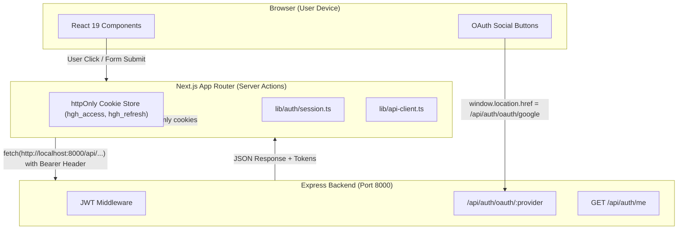

# Phase 1 — Auth Plumbing & Core Architecture Learning Guide

Welcome to the **Phase 1 Learning Guide** for **Hollow Game Hub**! This document explains the architectural principles, design patterns, and code structure implemented during Phase 1. Use this as a step-by-step learning reference to understand how a modern Next.js 16 (App Router) frontend securely interacts with an Express REST API.

---

## 1. Core Mental Model: The Client–Server Network Boundary



### Key Concepts:
1. **Network Boundary:** Client-side JavaScript in the browser **never** connects directly to MongoDB. Every request goes through the Express API or Next.js Server Actions.
2. **Access vs Refresh Tokens:**
   - **Access Token (`hgh_access`):** Short-lived JWT (~15 min) sent as `Authorization: Bearer <token>` header for authorized API endpoints.
   - **Refresh Token (`hgh_refresh`):** Long-lived token (~7 days) stored in an `httpOnly` cookie. `httpOnly` means browser JavaScript cannot inspect or steal it via XSS.
3. **Silent Refresh:** When an access token expires (HTTP 401), `apiRequest` automatically triggers `/api/auth/refresh` behind the scenes, stores the fresh access token, and transparently retries the original request.

---

## 2. Code Structure & Modified Files Walkthrough

### 📁 `lib/api-client.ts` — Centralized API Fetcher & Interceptor
> **Purpose:** Handles all communication with the Express backend, manages token headers, transparently handles 401 retries, and parses 429 Rate-Limit headers.

```typescript
export class ApiError extends Error {
  status: number;
  rateLimitReset: number | null;

  constructor(status: number, message: string, rateLimitReset: number | null = null) {
    super(message);
    this.name = "ApiError";
    this.status = status;
    this.rateLimitReset = rateLimitReset;
  }
}
```

#### What you're learning here:
- **Custom Error Types:** `ApiError` extends native `Error` to preserve HTTP status codes (`401`, `429`, `500`) and headers (like `RateLimit-Reset`).
- **Response Interception:** Before throwing an error on 401 status, `apiRequest` calls `refreshAccessToken()` and retries once (`retryOn401: false`).

---

### 📁 `app/actions/auth-actions.ts` — Next.js Server Actions
> **Purpose:** Bridge component form submissions to the backend API without exposing server credentials.

```typescript
export async function getCurrentUserAction() {
  try {
    const response = await apiRequest("/api/auth/me", { method: "GET" });
    return {
      success: true,
      user: response?.user || response || null,
    };
  } catch (error: unknown) {
    return { success: false, user: null, error: errorMessage(error) };
  }
}
```

#### What you're learning here:
- **`"use server"` Directive:** Executes exclusively on the Next.js server node. Client JS receives a transparent RPC function.
- **Session Mutation:** Uses `setSession()` and `clearSession()` from `lib/auth/session.ts` to manage httpOnly cookies on response headers.

---

### 📁 `components/HeaderProfile.tsx` — Dynamic Session State Binding
> **Purpose:** Fetches current authenticated user data from `GET /api/auth/me` on mount and renders an 8-bit retro dropdown menu with user profile details and sign-out controls.

```tsx
export default function HeaderProfile() {
  const [user, setUser] = useState<IUser | null>(null);

  useEffect(() => {
    async function loadUser() {
      const res = await getCurrentUserAction();
      if (res.success && res.user) setUser(res.user);
    }
    loadUser();
  }, []);
  
  // Render retro DropdownMenu with initials fallback and Logout trigger
}
```

#### What you're learning here:
- **Client Hydration:** Renders fallback initials (e.g. `P1` or user email initials) while fetching profile asynchronously.
- **Clean Logout Flow:** Calling `logoutAction()` clears server-side cookies, displays a success toast, and redirects to `/auth/login`.

---

### 📁 `components/ui/8bit/blocks/login-form.tsx` & `sign-up-form.tsx` — OAuth SSO Redirects
> **Purpose:** Enables one-click Third-Party Sign-In (Google, GitHub, Microsoft).

```tsx
onClick={() => {
  const provider = label.toLowerCase();
  const apiUrl = process.env.NEXT_PUBLIC_API_URL || "http://localhost:8000";
  window.location.href = `${apiUrl}/api/auth/oauth/${provider}`;
}}
```

#### What you're learning here:
- **OAuth Authorization Code Redirect:** OAuth SSO cannot be called via simple AJAX/JSON `fetch` because the provider (Google/GitHub/MS) must display a browser consent page. `window.location.href` initiates a full-page redirect to the backend OAuth handler.

---

## 3. Summary Checklist of Phase 1 Progress

- [x] **Global TanStack Query Provider:** Verified `<Providers>` wrapper mounted in `app/layout.tsx`.
- [x] **API Client Hardening:** Added HTTP 429 RateLimit header parsing in `lib/api-client.ts`.
- [x] **User Profile Action:** Added `getCurrentUserAction()` in `app/actions/auth-actions.ts` calling `GET /api/auth/me`.
- [x] **Dynamic Header Profile:** Upgraded `HeaderProfile.tsx` with user state binding, initials avatar fallback, and retro dropdown menu with Logout.
- [x] **OAuth SSO Wiring:** Connected Google, GitHub, and Microsoft social buttons to `${BASE_URL}/api/auth/oauth/<provider>`.

---

## 4. Next Step: Phase 2 (AI Gaming Assistant UI)

Now that authentication plumbing, token handling, and user profile session states are active, you can proceed to **Phase 2 — AI Gaming Assistant (`/club/chat`)**:
1. Next.js SSE Stream Proxy (`app/api/gaming/ask/stream/route.ts`).
2. 2-Pane Chat Shell with 8-bit styling (`ChatShell.tsx`, `ChatThread.tsx`, `Composer.tsx`).
3. Streamed token typewriter hook (`useChatStream.ts`).
