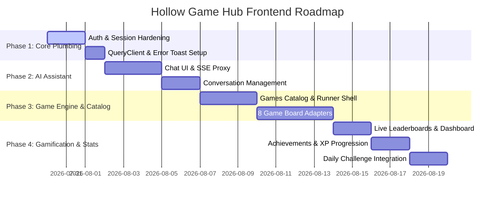

# Hollow Game Hub — Frontend Master Integration & Implementation Plan

> **Backend Reference Documents:** `backend/docs/frontend-guide.md`, `backend/docs/gaming-assistant-plan.md`, `backend/openapi.json`  
> **Frontend Target:** `hollow-game-hub/` (Next.js 16.2.2 App Router, React 19.2, Tailwind CSS v4, 8bit retro UI components, TanStack Query v5, Zod v4)

---

## 1. Architectural & Gap Analysis

The backend (`backend/`) is a fully featured REST + SSE Express API backed by MongoDB and Groq LLM. The frontend (`hollow-game-hub/`) currently has retro 8-bit styling and initial auth/chat setups, but currently relies on static data for dashboards and lacks full integration with the backend API surface.

### Backend API Surface vs Frontend Status

| Backend Domain | API Endpoints | Current Frontend Status | Gap / Required Action |
| --- | --- | --- | --- |
| **Auth & SSO** | `POST /api/auth/register`, `login`, `refresh`, `logout`, `GET /me`, `GET /oauth/:provider` | Login/Signup forms set httpOnly cookies | Add OAuth SSO buttons (Google, GitHub, MS), Profile Header state binding, client-side logout flow |
| **Gaming AI Assistant** | `POST /api/gaming/ask`, `/ask/stream`, `GET/DELETE /api/gaming/conversations[/:id]` | Skeleton layout in `app/club/chat` | Complete ChatShell, SSE streaming hook, markdown bubble renderer, conversation sidebar |
| **Game Engine** (8 Games) | `GET /api/games`, `POST /api/games/:slug/start`, `POST /api/games/sessions/:id/move`, `GET /scores/me` | Missing completely | Create Game Catalog page, Game Runner shell, dynamic move form renderer, game board adapters |
| **Leaderboards** | `GET /api/games/:slug/leaderboard`, `/leaderboard/global`, `/games/daily/leaderboard`, `/progression/leaderboard` | `app/club/dashboard` uses `dashboard/data.json` | Replace static JSON with real TanStack Query tabbed leaderboards (Global, Per-game, Daily, XP) |
| **Daily Challenge** | `GET /api/games/daily`, `POST /api/games/daily/start` | Missing completely | Create Daily Challenge Card component on dashboard/menu with single-attempt locking UX |
| **Gamification & Badges** | `GET /api/achievements`, `GET /api/achievements/me` | Missing completely | Build Achievements/Badges Grid (unlocked colored vs locked grayed out with unlock dates) |
| **Progression System** | `GET /api/progression/me` | Hardcoded level/health in `HeaderProfile.tsx` | Bind XP progress bar, level badge, streak counter to `/api/progression/me` data with live refetching |

---

## 2. Detailed Technical Plan by Module

### Module 1: Auth & SSO Plumbing (`app/auth/`, `components/HeaderProfile.tsx`)
- **OAuth SSO Redirect Buttons:** Add "Sign in with Google", "GitHub", and "Microsoft" buttons pointing to `${BASE_URL}/api/auth/oauth/<provider>` for full-page redirect flow.
- **Session Syncing:** Utilize `getAccessToken()` and `refreshAccessToken()` inside Server Actions & Route Handlers.
- **Header Profile Integration:** Fetch `GET /api/auth/me` on layout load; display actual username, email, avatar, and active role. Add logout trigger that executes `POST /api/auth/logout` and clears cookies.

### Module 2: AI Gaming Assistant (`app/club/chat/`)
- **SSE Stream Proxy:** `app/api/gaming/ask/stream/route.ts` proxies streaming responses from Express while passing the session cookie.
- **UI Components:**
  - `ChatShell.tsx`: 2-pane responsive layout (mobile drawer via 8bit drawer).
  - `ConversationList.tsx`: List past threads with optimistic deletion & retro pixel selection state.
  - `ChatThread.tsx`: Auto-scrolling transcript with `aria-live="polite"` for accessibility.
  - `Composer.tsx`: Retro 8-bit `textarea` supporting `Enter` to submit, `Shift+Enter` for multiline, and Stop streaming button.
  - `MessageBubble.tsx`: Styled card bubbles for User vs Assistant with typewriter cursor effect.

### Module 3: Games Engine & Catalog (`app/club/games/`)
- **Game Catalog (`/club/games`)**: Render cards from `GET /api/games` detailing game title, description, slug, and category.
- **Game Session Runner (`/club/games/[slug]`)**:
  - `POST /api/games/:slug/start` generates session ID & initial `view`.
  - Dynamic Form: Inspects `moveSchema` from backend catalog and renders appropriate controls (number input, choice picker, text input, etc.).
  - `POST /api/games/sessions/:id/move` sends player move, receives updated `view`, score, and inline `progression` + `newAchievements`.
- **Game Specific Boards:**
  - Standardized View renderer handles Wordle grid, Hangman masked word, Quiz multi-choice, Trivia, Rock-Paper-Scissors, Number Guessing, etc.
- **Inline Reward Toasts:** Fire retro confetti and `sonner` / `react-hot-toast` notifications when `newAchievements` or `progression.levelUp` is returned in the move payload.

### Module 4: Live Leaderboards (`app/club/dashboard/` & `components/data-table.tsx`)
- Replace `data.json` with live Server Actions / TanStack Query hooks fetching:
  - Global Leaderboard (`/api/games/leaderboard/global`)
  - Per-Game Leaderboard (`/api/games/:slug/leaderboard`)
  - Daily Leaderboard (`/api/games/daily/leaderboard`)
  - Progression/XP Leaderboard (`/api/progression/leaderboard`)
- Wrap in retro 8-bit `Tabs` component with ranking badges (🥇 🥈 🥉) for top 3 players.

### Module 5: Daily Challenge & Streak Counter (`components/DailyChallengeCard.tsx`)
- Fetch `GET /api/games/daily` on main menu / dashboard.
- If not played today: show active "PLAY DAILY CHALLENGE" CTA leading to `/club/games/daily`.
- If completed today (or `409` conflict): render "COMPLETED TODAY" state with countdown timer to next UTC daily refresh.
- Show current daily streak 🔥 with retro flame animations.

### Module 6: Badges & Achievements Wall (`app/club/achievements/`)
- Fetch all achievements (`/api/achievements`) and user achievements (`/api/achievements/me`).
- Render pixelated 8-bit badge grid displaying badge title, description, category, and unlock date.
- Locked badges rendered in retro grayscale with lock icon; unlocked rendered in full vibrant colors with glow effect.

### Module 7: Player Progression Bar (`components/ui/8bit/mana-bar.tsx`, `HeaderProfile.tsx`)
- Bind progression state from `GET /api/progression/me`:
  - Player Level badge
  - XP Progress Bar (`progressPct` towards next level)
  - Current Streak & Longest Streak
- Re-query progression key upon game finish or daily completion to animate level-up bar smooth filling.

---

## 3. Implementation Roadmap & Milestones

### Phase 1: Foundation & Auth Hardening
1. Add `GET /api/auth/me` fetcher and link profile data into `HeaderProfile.tsx`.
2. Add OAuth provider SSO links (`/api/auth/oauth/google`, `/api/auth/oauth/github`, `/api/auth/oauth/microsoft`) on login/signup forms.
3. Validate global `QueryClientProvider` mounting in `app/layout.tsx`.

### Phase 2: AI Gaming Assistant (Complete Chat)
1. Complete `/app/api/gaming/ask/stream/route.ts` proxy for httpOnly token pass-through.
2. Build out `app/club/chat/page.tsx` with full 2-pane retro layout (`ChatShell`, `ConversationList`, `ChatThread`, `Composer`).
3. Connect optimistic conversation deletion and title refetching.

### Phase 3: Games Engine & Catalog
1. Create `app/actions/game-actions.ts` covering `/api/games`, `/:slug/start`, `/sessions/:id/move`, `/scores/me`.
2. Create `/app/club/games/page.tsx` (Game Catalog grid).
3. Create `/app/club/games/[slug]/page.tsx` (Game Runner with dynamic move submission and board views).
4. Implement inline level-up / badge unlock popups upon game completion.

### Phase 4: Leaderboards, Achievements & Progression
1. Create `app/actions/leaderboard-actions.ts` and `progression-actions.ts`.
2. Refactor `app/club/dashboard/page.tsx` to replace static `data.json` with live Leaderboards table.
3. Create `app/club/achievements/page.tsx` (Badges wall).
4. Connect header XP/Mana bar to `/api/progression/me`.
5. Implement Daily Challenge card with streak counter.

---

## 4. Verification & Testing Strategy
- **Auth Verification:** Test login/signup, silent refresh on expired access token, OAuth redirect links, and logout.
- **AI Streaming Verification:** Confirm token-by-token streaming UI works in `/club/chat` with stop button capability.
- **Game Engine Verification:** Play all 8 game types to completion, verifying server-driven `view` updates, score updates, and XP reward notifications.
- **Leaderboard & Progression Verification:** Verify score submission reflects on global and per-game leaderboards and updates XP level.
