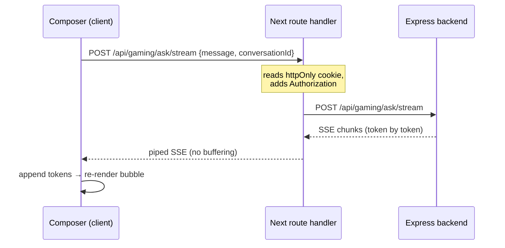

# Gaming Query Assistant — Frontend (UI) Plan

Companion to the backend plan at `backend/docs/gaming-assistant-plan.md`.
This document specifies the **Hollow Game Hub** UI that consumes that API.

> **Frontend stack (actual):** Next.js 16.2.2 (App Router) · React 19.2 · Tailwind v4 ·
> shadcn + **8bitcn retro components** · GSAP 3.14 · TanStack Query v5 · Zod 4 · react-hot-toast

Phasing mirrors the backend so the two can ship in lockstep:

- **Phase 1 — Chat MVP:** conversation list + thread + streaming composer. Consumes `/ask`, `/ask/stream`, conversation CRUD.
- **Phase 2 — Sources & tools:** render `sources[]`, show tool-call progress ("Consulting IGDB…").
- **Phase 3 — RAG citations:** inline citation markers + expandable grounded-source cards.

---

## 0. Current frontend state — gaps to close first

These were verified against the repo, not assumed. **Phase 1 is blocked on §0.1–0.3.**

| # | Finding | Impact | Action |
| --- | --- | --- | --- |
| 0.1 | `components/providers.tsx` wraps `QueryClientProvider`, but is **never mounted** in `app/layout.tsx` | No React Query anywhere | Mount `<Providers>` in the root layout |
| 0.2 | `lib/api-client.ts` sends **no `Authorization` header**; `loginUserAction` returns the JWT but **nothing persists it** | Every authenticated endpoint 401s | Persist token + attach it (§4.1) |
| 0.3 | `apiRequest` always ends in `res.json()` | **Cannot consume SSE** — `/ask/stream` is impossible through it | Add a separate streaming client (§4.3) |
| 0.4 | No `.env*` file; `NEXT_PUBLIC_API_URL` unset → falls back to placeholder `https://api.your-backend.com` | All calls hit a dead host | Add `.env.local` (§8) |
| 0.5 | `app/club/chat/page.tsx` is a stub (`<div>CHat</div>`) | — | This is the assistant's home |
| 0.6 | Missing primitives: **no `textarea`, no `scroll-area`** in `components/ui` *or* `components/ui/8bit` | Composer + thread scroll need them | `npx shadcn add textarea scroll-area`, then wrap retro-style |

Already in place and reusable: 8bit `card, button, input, avatar, badge, skeleton, separator, tabs, drawer, dropdown-menu`; `Header`/`HeaderProfile`; the retro pixel-border + scanline patterns from the auth forms; `useRetroTheme`; the dashboard sidebar **already links to `/club/chat`**.

---

## 1. Where this fits in the current app

```
app/
├── club/
│   ├── layout.tsx                  # existing shell (Header + scroll container)
│   └── chat/
│       ├── page.tsx                # ← replace stub: server component, prefetch conversations
│       ├── [conversationId]/
│       │   └── page.tsx            # deep-linkable thread
│       └── components/
│           ├── ChatShell.tsx       # 2-pane layout + mobile drawer
│           ├── ConversationList.tsx
│           ├── ChatThread.tsx      # message list + autoscroll
│           ├── MessageBubble.tsx   # user / assistant / refusal variants
│           ├── Composer.tsx        # textarea + send/stop
│           ├── SourceChips.tsx     # Phase 2
│           └── ToolActivity.tsx    # Phase 2
├── api/gaming/ask/stream/route.ts  # SSE proxy (see §4.3 — required for httpOnly cookies)
└── actions/gaming-actions.ts       # server actions: conversation CRUD, non-streaming ask

lib/
├── api-client.ts                   # extend: auth header + error typing
├── gaming/
│   ├── types.ts                    # zod schemas mirroring backend contracts
│   ├── queries.ts                  # React Query keys + hooks
│   └── stream.ts                   # SSE reader (client)
hooks/
└── useChatStream.ts                # streaming state machine
```

---

## 2. Backend endpoint → UI surface

| Backend | UI surface | Data strategy |
| --- | --- | --- |
| `POST /ask` | Composer send (non-stream fallback) | Server action → `revalidate`/invalidate |
| `POST /ask/stream` | Composer send (default) | **Client** fetch + `ReadableStream` via proxy route |
| `POST /conversations` | "New chat" button | Mutation → optimistic insert |
| `GET /conversations` | Conversation sidebar | Query, prefetched server-side |
| `GET /conversations/:id` | Thread view | Query keyed by id; SSR on deep link |
| `DELETE /conversations/:id` | Row context menu | Mutation → optimistic remove + undo toast |

Response fields map to UI as: `answer` → bubble text · `usage` → optional token meter · `model` → subtle footer tag · `sources[]` → §6 (empty in Phase 1).

---

## 3. Screen layout

Two panes on desktop, drawer on mobile — consistent with the responsive rules already applied app-wide (stack below `md`, no fixed widths that force horizontal scroll).

```
┌──────────────────────────── Header (existing) ─────────────────────────────┐
├───────────────────┬────────────────────────────────────────────────────────┤
│ Conversations     │  ChatThread (scroll region, aria-live=polite)          │
│  + New chat       │   ┌ assistant ─────────────┐                            │
│  · Elden Ring…    │   │ pixel avatar + bubble  │                            │
│  · BG3 prices     │   └────────────────────────┘                            │
│  (md:w-72)        │                    ┌─ user ─────────┐                   │
│                   │                    └────────────────┘                   │
│                   ├────────────────────────────────────────────────────────┤
│                   │  Composer: textarea + Send / Stop                       │
└───────────────────┴────────────────────────────────────────────────────────┘
```

**Responsive contract** (matches the conventions already enforced in this repo):

| Breakpoint | Behavior |
| --- | --- |
| `< md` | Single column. Conversation list moves into the 8bit **`drawer`** behind a "Chats" button. Composer sticks to bottom with safe-area padding. |
| `md+` | Sidebar `w-64`/`w-72` + flexible thread. No fixed pixel widths on the thread. |
| any | Long code/table answers scroll **inside** their own `overflow-x-auto` container — never the page (same rule that fixed the dashboard table). |

---

## 4. Data layer

### 4.1 Auth — decide this first (blocks everything)

The backend protects every `/api/gaming/*` route with JWT. Two options:

| | A. `localStorage` token | **B. httpOnly cookie (recommended)** |
| --- | --- | --- |
| Client can read token | Yes | No |
| XSS exposure | **Token stealable** | Not readable by JS |
| Streaming | Client fetches backend directly | Must proxy through a Next route handler (§4.3) |
| Change needed | Store token on login | Set cookie in `loginUserAction`; add proxy route |

**Recommendation: B.** Set the cookie in the existing server action. Note Next 16 made
request APIs async — `cookies()` **must be awaited** (synchronous access was removed):

```ts
// app/actions/auth-actions.ts (extend loginUserAction)
import { cookies } from "next/headers";

const cookieStore = await cookies();          // ← await required in Next 16
cookieStore.set("token", response.token, {
  httpOnly: true, secure: true, sameSite: "lax", path: "/", maxAge: 60 * 60 * 24 * 7,
});
```

Then extend `apiRequest` to attach it server-side:

```ts
// lib/api-client.ts
export async function apiRequest(endpoint: string, options: RequestInit = {}) {
  const token = (await cookies()).get("token")?.value;   // server-side callers
  const res = await fetch(`${BASE_URL}${endpoint}`, {
    ...options,
    headers: {
      "Content-Type": "application/json",
      ...(token ? { Authorization: `Bearer ${token}` } : {}),
      ...options.headers,
    },
  });
  if (!res.ok) throw await toApiError(res);   // typed error incl. 401 / 429
  return res.json();
}
```

> Because `cookies()` is server-only, keep `apiRequest` for **server actions / RSC**.
> Client components reach the API through server actions or the proxy route — never
> by importing `apiRequest`.

### 4.2 Query keys & caching

```ts
export const gamingKeys = {
  conversations: ["gaming", "conversations"] as const,
  conversation: (id: string) => ["gaming", "conversation", id] as const,
};
```

- `GET /conversations` — `staleTime` 60s (matches the existing `Providers` default).
- Sending a message **optimistically appends** the user bubble, then streams the assistant bubble in; on success invalidate `conversation(id)` and `conversations` (title may be auto-generated server-side).
- Delete — optimistic removal + "Undo" toast (`react-hot-toast`, already used by the auth forms).

### 4.3 Streaming (`/ask/stream`) — the one real architectural constraint

Two hard constraints drive the design:

1. **`EventSource` can't be used** — it is GET-only and cannot send an `Authorization` header or a JSON body. Use `fetch` + `ReadableStream`.
2. With **httpOnly cookies (option B)** the browser can't attach the bearer token to a cross-origin call, so the stream is proxied through a Next route handler that injects it and pipes the body straight back.



```ts
// app/api/gaming/ask/stream/route.ts
export async function POST(req: Request) {
  const token = (await cookies()).get("token")?.value;
  const upstream = await fetch(`${process.env.API_URL}/api/gaming/ask/stream`, {
    method: "POST",
    headers: { "Content-Type": "application/json", Authorization: `Bearer ${token}` },
    body: await req.text(),
  });
  return new Response(upstream.body, {           // pipe through, do not buffer
    headers: { "Content-Type": "text/event-stream", "Cache-Control": "no-cache" },
  });
}
```

`useChatStream` owns the state machine: `idle → streaming → done | error | aborted`,
exposes `{ text, status, send, stop }`, and holds an `AbortController` so **Stop** works.
Guard against React 19 StrictMode double-invoke by keying the controller per request.

---

## 5. Phase 1 — Chat MVP (retro design language)

Reuse the visual vocabulary already established in the auth forms so the assistant feels native:

| Element | Treatment |
| --- | --- |
| **Message bubbles** | 8bit `Card` pixel borders. Assistant = `bg-card`; user = `bg-muted`, right-aligned. Sharp corners (`--radius: 0`) — no rounded bubbles. |
| **Avatars** | 8bit `Avatar`; assistant uses the pixel **gamepad brand mark** (same as `Header`/sidebar) for continuity. |
| **Streaming cursor** | Blinking `_` — reuse the `steps(1)` GSAP tween already written for the login title. |
| **Thinking state** | 8bit `Skeleton` lines, or a retro "LOADING…" with the existing scanline overlay. |
| **Composer** | `textarea` (§0.6) with pixel border + the GSAP focus-glow helper from the login form. `Enter` sends, `Shift+Enter` newlines. |
| **Empty state** | Retro splash: gamepad mark + "ASK GG ANYTHING ABOUT GAMES" + 3–4 suggested prompt chips. |
| **Errors** | 8bit `Alert` destructive, matching the auth `customToast` pattern. |
| **Off-topic refusal** | The backend's domain guard returns a polite decline as a normal answer. Render it as a standard assistant bubble with a subtle `Badge` ("off-topic") — **do not** style it as an error. |

**Motion (GSAP), consistent with existing components:** bubbles enter with a short
`y`+`opacity` tween; stagger only on first paint of a thread, never per streamed token
(that would thrash). Every timeline must respect
`prefers-reduced-motion` and be scoped in `gsap.context()` with `ctx.revert()` cleanup —
the same pattern used in `login-form.tsx` and `LandingPage.tsx`.

**Accessibility**
- Thread container `aria-live="polite"` + `aria-busy` while streaming, so screen readers announce answers without spamming per token.
- Composer has a real `<label>` (visually hidden); Stop button is focusable and labelled.
- Maintain visible focus rings — the retro theme must not remove them.

---

## 6. Phase 2 — Sources & tool activity

When the backend starts returning populated `sources[]` and performing tool-call loops:

- **`SourceChips`** — a row of 8bit `Badge`s under the answer (`IGDB`, `Steam`, …), each linking out. Keep them below the text, not inline, so Phase 1 layout is unchanged.
- **`ToolActivity`** — because tool calling is a *loop*, surface progress: "Consulting IGDB…" → "Fetching Steam price…". Render as a transient muted line above the streaming bubble; collapse into a "2 sources" summary when done.
- Requires the SSE stream to emit typed events (`token`, `tool_start`, `tool_end`, `done`). **Coordinate this event schema with the backend** — it is the main frontend/backend contract for Phase 2 (see §10).

---

## 7. Phase 3 — RAG citations

- Inline markers `[1]`, `[2]` in the answer, click → scrolls to / expands the matching source card.
- Expandable `KnowledgeChunk` cards showing `title`, snippet, and `source`.
- A "grounded" badge distinguishes RAG-backed answers from built-in-knowledge ones — meaningful trust signal once §6 and §7 coexist.

---

## 8. Config

```bash
# .env.local  (currently missing entirely — see §0.4)
NEXT_PUBLIC_API_URL=http://localhost:5000     # client-safe base (non-streaming, if option A)
API_URL=http://localhost:5000                 # server-only, used by the proxy route
```

Keep the streaming proxy on `API_URL` (server-only) so the backend origin isn't required to be public.

---

## 9. Suggested build order

1. **Unblock foundations** — mount `<Providers>`, add `.env.local`, add `textarea` + `scroll-area` (§0).
2. **Auth wiring** — set httpOnly cookie on login; attach `Authorization` in `apiRequest`; handle 401 → redirect to `/auth/login`.
3. **Types** — Zod schemas mirroring the backend contracts in §2 of the backend plan.
4. **Conversation CRUD** — sidebar list, new, delete (non-streaming; proves auth end-to-end).
5. **Non-streaming `/ask`** — simplest correct round trip.
6. **Streaming** — proxy route + `useChatStream` + Stop.
7. **Retro polish** — GSAP entrances, empty state, skeletons, reduced-motion pass.
8. **Responsive pass** — mobile drawer, sticky composer, verify zero horizontal overflow at 375px.
9. **Phase 2** — typed stream events, `ToolActivity`, `SourceChips`.
10. **Phase 3** — citation markers + source cards.

---

## 10. Open decisions to confirm

- **Auth storage — A or B?** (§4.1) Everything downstream, especially streaming, depends on it. Recommended: **B, httpOnly cookie**.
- **SSE event schema for Phase 2** — the backend plan doesn't yet specify the wire format for tool-call progress. Frontend needs `token` / `tool_start` / `tool_end` / `done` (or equivalent) to build §6.
- **Conversation titles** — auto-generated server-side from the first message, or user-editable? Affects whether the sidebar needs inline rename.
- **Rate limiting UX** — backend will return 429; decide between a blocking modal, a disabled composer with countdown, or a toast.
- **`usage` tokens** — surface per-message cost to users, or keep it dev-only?
- **Does the assistant live inside the club shell?** `/club/chat` currently inherits `club/layout.tsx` (Header + centered container). A full-height chat may want to opt out of the centered container — the same nesting question already flagged for the dashboard.

> *Companion document — Phase 1 is fully specified and implementable once §0 and §4.1 are settled;
> Phases 2–3 depend on the open contracts in §10.*
